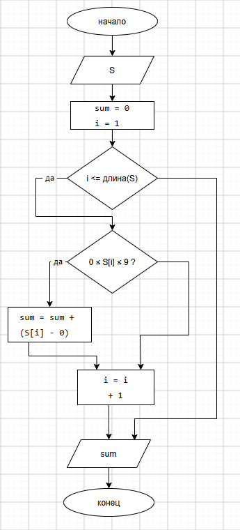

# Лабораторная работа №13
  
Студент: Полякова В.Д.
Группа: бТИИ-261

## Задание

Программа запрашивает имя пользователя, переводит его в заглавные буквы и выводит приветствие, дополняя его восклицательными знаками до общей длины строки в 40 символов.
Программа берет строку «Привет, Вася» и вставляет символ подчеркивания _ перед последней буквой каждого слова.
Программа запрашивает у пользователя предложение и находит сумму всех цифр в введенном предложении.\n

**Требуется:**
1. Составить блок-схему алгоритма решения.
2. Написать программу на языке C.

## Блок-схема

